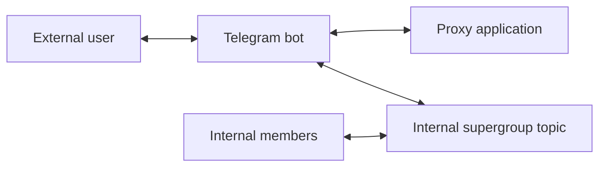

# Telegram Chat Proxy — Business Requirements

**Status:** MVP baseline  
**Product type:** Single-tenant Telegram message proxy

## 1. Purpose

The product provides anonymous, bidirectional communication between an external Telegram user and an internal team.

The external user communicates only with the Telegram bot. The same bot is an administrator of the internal supergroup
and carries every proxy interaction. Internal members communicate inside a forum topic and do not expose their Telegram
identities to the external user.

## 2. Deployment model

- One application deployment serves one organization.
- Each deployment has one Telegram bot and one internal supergroup.
- Another organization is supported by deploying another application instance with separate configuration.
- Multi-tenant routing, tenant selection, and cross-tenant reporting are out of scope.

## 3. Actors

| Actor | Responsibility |
|---|---|
| External user | Sends messages to and receives messages from the Telegram bot. |
| Internal member | Reads and writes messages inside the mapped supergroup topic. |
| Telegram bot | Customer-facing identity that also polls the internal supergroup, creates topics, and transports messages. |
| Proxy application | Persists, routes, orders, retries, and relays messages. |

## 4. Core business rules

### 4.1 One topic per external chat

- One external private chat maps to one current forum topic.
- The mapping is retained in the application database.
- A topic is created when the first relay is required and no topic is currently mapped.
- Later messages reuse the mapped topic.

### 4.2 Topic title

The topic title is selected at creation time using this fallback order:

1. `@username`
2. Telegram display name
3. `User <Telegram user ID>`

Existing topics are not renamed when the user changes their profile. A replacement topic uses the profile information available when it is created.

### 4.3 External-to-internal relay

- Eligible private messages sent to the Telegram bot are relayed into the mapped internal topic.
- If no topic exists, the application creates one before relaying.
- If Telegram reports that the mapped destination topic is missing, the application creates a replacement topic, updates the mapping, and retries the relay once.
- If topic creation has an ambiguous outcome, the operation fails for manual review rather than automatically risking duplicate topic creation.

### 4.4 Internal-to-external relay

- Any human member of the internal supergroup may write inside a mapped topic.
- Every eligible human message in that topic is relayed to the corresponding external user.
- No assignment, ownership, department, or agent permission model exists in the MVP.
- Messages created by bots, commands, service messages, and messages in unmapped topics are not relayed.

### 4.5 Anonymity

- The external user sees only the Telegram bot.
- Internal members' Telegram accounts are not exposed through relayed messages.
- Internal discussions outside mapped topics are not sent externally.

### 4.6 Start command

- The Telegram bot responds to `/start` in a private chat with a configurable message.
- The message explains that communication is being proxied to an internal team.
- External commands other than `/start` are ignored.
- Commands written in internal topics are ignored in the MVP.

### 4.7 Delivery failures

- Retryable failures are retried with configurable backoff.
- Non-retryable failures fail immediately.
- Exhausted failures remain stored for manual investigation.
- Permanent delivery failures are not announced automatically in either Telegram chat.

## 5. Supported content

The MVP relays immutable Telegram messages supported by `copyMessage`, including:

- Text and captions
- Photos
- Videos
- Animations
- Audio
- Voice messages
- Documents
- Stickers
- Locations
- Contacts

The application does not transform unsupported content into another format.

## 6. Explicitly out of scope

- Message edits
- Message deletion synchronization
- Reactions
- Polls and live locations
- Calls and video chats
- Payments and Mini Apps
- Topic close/reopen controls
- Application-managed topic deletion
- Automatic retention cleanup
- CRM features, assignments, tags, priorities, SLAs, analytics, and web dashboard
- Administrative UI for failed records
- Permanent independent message archive

## 7. Acceptance criteria

1. A new external user message results in one mapped internal topic and one relayed message.
2. Subsequent external messages reuse the same topic.
3. Human messages written in a mapped topic are relayed to the correct external user.
4. Messages from different chats may be relayed concurrently.
5. Messages within one chat are delivered in assigned chat-offset order.
6. Restarting or replacing an application replica does not lose a Telegram update that was transactionally persisted.
7. Duplicate Telegram updates do not create duplicate inbox records.
8. Retryable delivery failures are retried; exhausted or permanent failures remain available for manual investigation.
9. The external user never receives an internal member's Telegram identity through the proxy.
10. A missing mapped topic is recreated during the next external-to-internal relay.

## 8. Glossary

| Term | Meaning |
|---|---|
| Telegram bot | Single bot used for private chats, supergroup polling, topic management, and message copying. |
| External chat | Private chat between an external user and the Telegram bot. |
| Internal topic | Forum topic in the configured internal supergroup. |
| Chat | Persistent mapping between an external chat and an internal topic. |
| Inbox | Durable Telegram updates not yet successfully converted into application operations. |
| Outbox | Durable high-level operations not yet successfully executed against Telegram. |
| Chat offset | Ordered position of an outbox operation inside one chat partition. |
| Fenced lease | Time-limited ownership protected by a monotonically increasing version. |
