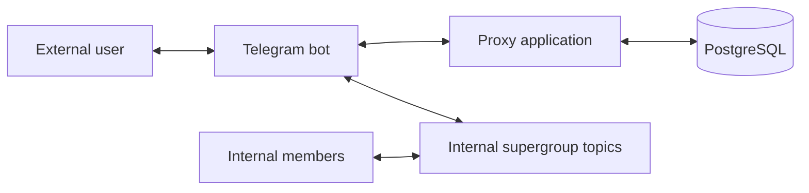
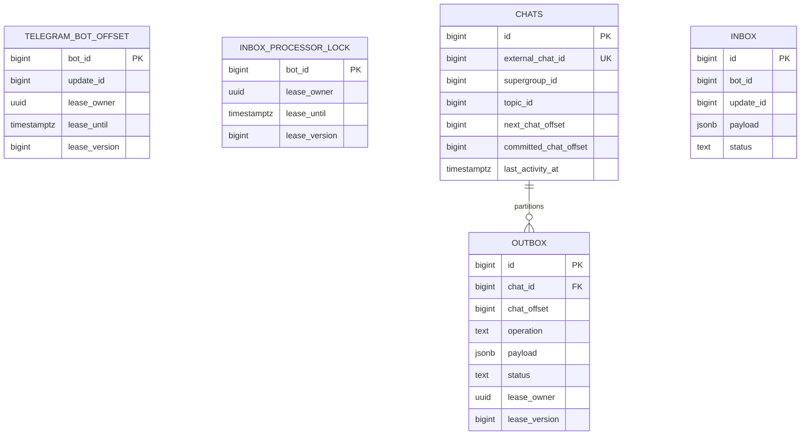

# Telegram Chat Proxy — Solution Design

**Status:** MVP implementation baseline  
**Database:** PostgreSQL 15+  
**Telegram integration:** Bot API long polling

## 1. Design principles

- Telegram updates are persisted before their polling offset is advanced.
- Telegram network calls do not run inside database transactions.
- Inbox processing and outbox publishing are separate responsibilities.
- Delivery is at least once; avoiding message loss has priority over eliminating every possible duplicate.
- `chat_id` is the outbox partition key.
- `chat_offset` is the ordered position inside that partition.
- Different chats execute concurrently; one chat executes sequentially.
- Successful inbox and outbox rows are deleted.
- Exhausted failures remain permanently until manually reset or otherwise repaired.

## 2. Runtime topology



### Telegram bot

- Receives private user messages.
- Sends messages to external users.
- Is an administrator of the internal supergroup.
- Has permission to manage forum topics.
- May keep Telegram Privacy Mode enabled because bot administrators receive ordinary human topic messages.
- Copies external messages into topics.
- Copies internal topic messages to external users.
- Polls messages written by internal members.
- Creates forum topics.

### Deployment prerequisite

The deployment must verify that the configured bot receives ordinary human messages from forum topics and can copy those
messages to private users. Bot administration is a required part of the target Telegram setup; Privacy Mode may remain
enabled because administrators receive all human group messages.

## 3. Application components

| Component | Responsibility |
|---|---|
| Telegram poller | Calls `getUpdates` for the configured bot and transactionally persists returned updates and the next offset. |
| Inbox processor | Processes the bot's inbox stream in `update_id` order and creates high-level outbox operations. |
| Outbox publisher | Drains ready chat-head operations through a bounded global worker pool, refilling each free slot without waiting for unrelated in-flight operations. |
| Operation handler | Implements `relay_external_to_internal`, `relay_internal_to_external`, or `send_external_message`. |
| Retry classifier | Classifies failures as retryable or non-retryable and calculates the next attempt. |

Terminology such as “transformer” is not used.

## 4. Data model



## 5. Configuration contract

Configuration is defined in `config.yaml`.

The existing project structure is responsible for binding configuration, resolving secret placeholders, and integrating with the selected framework.

Required configuration areas:

- Telegram bot identity, token, and polling settings
- Internal supergroup ID
- Configurable `/start` message
- Inbox batch, lease, and retry settings
- Outbox claim-batch, worker-pool, lease, and retry settings. The batch size limits one database claim; the worker-pool size limits concurrent Telegram operations.

## 6. Sequence 1 — Poll Telegram updates

One poller runs this algorithm for the configured bot.

1. Attempt to claim the bot's polling lease with a conditional `INSERT ... ON CONFLICT DO UPDATE ... RETURNING`.
2. A successful claim returns the current `update_id` and a new `lease_version`.
3. `update_id` is the next offset passed to `getUpdates`; a missing row is treated as offset `0`.
4. Commit the lease transaction.
5. Call `getUpdates` outside a database transaction.
6. For a non-empty response, calculate `next_offset = max(received update_id) + 1`.
7. Start a transaction.
8. Bulk insert all updates with `UNNEST` and `ON CONFLICT (bot_id, update_id) DO NOTHING`.
9. Update the offset to `GREATEST(current_offset, next_offset)`.
10. Release the lease.
11. Require matching `lease_owner` and `lease_version`; if no row is updated, roll back because the worker is stale.
12. Commit.

For an empty response, release the matching lease without changing the offset.

For an HTTP failure, do not change the offset. Release the lease if the process remains healthy; otherwise allow it to expire.

### Polling persistence shape

```sql
INSERT INTO inbox (bot_id, update_id, payload)
SELECT
    :bot_id,
    x.update_id,
    x.payload
FROM unnest(
    :update_ids::bigint[],
    :payloads::jsonb[]
) AS x(update_id, payload)
ON CONFLICT (bot_id, update_id) DO NOTHING;
```

The inbox insert, offset update, and lease release are committed atomically.

## 7. Sequence 2 — Process inbox updates

There is one active inbox processor for the bot stream.

1. Claim the bot's `inbox_processor_lock` fenced lease.
2. Select up to `inbox.batchSize` eligible rows for that bot:
   - status is `pending` or `retry`;
   - `available_at` has passed;
   - rows are ordered by `update_id`;
   - selected rows use short transactional `FOR UPDATE` locks.
3. Process the selected rows in ascending `update_id`.
4. Classify each update:
   - eligible external private message;
   - eligible internal human topic message;
   - external `/start`;
   - ignored command, bot message, service event, unsupported update, or unmapped internal topic.
5. Resolve or create the `chats` row.
6. For every created outbox operation, allocate the next `chat_offset` while locking the corresponding `chats` row.
7. Insert the outbox operation and increment `chats.next_chat_offset` in the same transaction.
8. Delete successfully processed and ignored inbox rows.
9. On a retryable processing error, increment `attempt_count` and set `available_at` using the inbox retry policy.
10. On a non-retryable or exhausted error, set status to `failed` and retain the row.
11. Renew or release the processor lease with the matching fencing token.
12. Commit.

A failed inbox row does not block later inbox updates.

## 8. Outbox operation model

The outbox stores application operations, not raw Telegram Bot API methods.

### `relay_external_to_internal`

```json
{
  "sourceChatId": 123456789,
  "sourceMessageId": 42,
  "topicTitle": "@example"
}
```

### `relay_internal_to_external`

```json
{
  "sourceChatId": -1001234567890,
  "sourceMessageId": 987
}
```

### `send_external_message`

```json
{
  "text": "Configured start message"
}
```

The destination identifiers are resolved through the associated `chats` row.

## 9. Chat partition and offset model

`chat_id` is the partition key. `chat_offset` is the operation position inside that partition.

```text
chat 10: offset 1 → offset 2 → offset 3
chat 20: offset 1 → offset 2
```

`chats` stores:

- `next_chat_offset`: next offset assigned to a new outbox operation.
- `committed_chat_offset`: highest successfully completed offset.

An outbox operation is eligible only when:

```text
outbox.chat_offset = chats.committed_chat_offset + 1
```

This avoids scanning for every earlier row and allows publishers to process many different chats concurrently.

A failed head operation blocks later operations for that chat until an operator resets or repairs it. Other chats continue normally.

## 10. Sequence 3 — Publish outbox operations

1. Start a scheduled publisher run with `workerPoolSize` global executor slots shared by every chat.
2. Calculate the currently free executor capacity.
3. Start a short claim transaction and select at most the smaller of the free capacity and `batchSize` ready chat-head operations:
   - status is `pending` or `retry`;
   - `available_at` has passed;
   - `chat_offset = committed_chat_offset + 1`;
   - rows are selected with `FOR UPDATE SKIP LOCKED`.
4. Set each claimed row to `processing`.
5. Set `lease_owner`, `lease_until`, and increment `lease_version`.
6. Commit and dispatch the claimed operations outside the database transaction to free workers.
7. When any operation finishes, complete its result using `lease_owner` and the claimed `lease_version`, then immediately use the newly free slot to claim and dispatch more eligible work.
8. Do not wait for other in-flight operations before refilling a free slot. Stop the publisher run only when no operation is in flight and a claim finds no eligible work; the configured interval starts the next run.

The dispatcher never claims more operations than it can execute immediately. Claimed leases therefore do not wait in a buffered in-memory backlog. Workers are global and interchangeable: PostgreSQL eligibility and fencing preserve per-chat ordering rather than stable chat-to-worker assignment.

### Success

In one transaction:

1. Delete the successful outbox row.
2. Set `chats.committed_chat_offset` to the completed `chat_offset`, requiring the previous committed value.
3. Update `last_activity_at` for successful relay operations.
4. Commit.

### Retryable failure

- Set status to `retry`.
- Clear the row lease.
- Store error details.
- Set `available_at` using the outbox retry policy.
- Telegram `retry_after` overrides the calculated delay.

### Permanent or exhausted failure

- Set status to `failed`.
- Clear the row lease.
- Store the final error.
- Retain the row permanently.
- Do not advance `committed_chat_offset`.

### Fenced lease behavior

If a lease expires and a row is reclaimed, the new claim increments `lease_version`. A stale worker's completion affects zero rows and its result is discarded.

## 11. Sequence 4 — Relay external message to internal topic

1. Load the associated `chats` row.
2. If `topic_id` is null:
   - call `createForumTopic` through the configured bot;
   - store the returned topic ID in `chats`.
3. Call `copyMessage` through the configured bot:
   - source is the external private chat;
   - destination is the configured supergroup and mapped topic;
   - set `reply_parameters.message_id` to the topic ID, which is also the topic root message ID, and keep
     `allow_sending_without_reply` false so Telegram cannot silently fall back to the General topic after deletion.
4. If Telegram reports that the destination topic is missing:
   - call `createForumTopic`;
   - replace `chats.topic_id`;
   - retry `copyMessage` once.
5. Complete the outbox operation using the normal success, retry, or failure policy.

Telegram may accept `message_thread_id` for a deleted topic while routing the copy to General. Pinning the copy to the
topic root makes deletion fail closed and preserves the replacement-topic recovery contract.

### Ambiguous topic creation

`createForumTopic` does not accept an application idempotency key. If its outcome is unknown, the operation is marked failed for manual investigation rather than automatically creating another topic.

## 12. Sequence 5 — Relay internal message to external user

1. The poller persists the supergroup update.
2. The inbox processor accepts only eligible human messages in mapped topics.
3. It ignores:
   - bot-authored messages;
   - commands;
   - Telegram service events;
   - messages outside the configured supergroup;
   - messages in unmapped topics.
4. It creates `relay_internal_to_external`.
5. The outbox handler calls `copyMessage` through the configured bot:
   - source is the internal supergroup message;
   - destination is the mapped external private chat.
6. Complete using the normal outbox policy.

If the source topic or source message disappears before copying, the operation cannot be reconstructed and follows the normal retry/failure policy.

## 13. `/start` behavior

- An external `/start` update creates or resolves a `chats` row.
- The inbox processor creates `send_external_message` using the configured text.
- Other external commands are ignored.
- All internal commands are ignored.

## 14. Retry policy

Inbox and outbox have independent configuration.

A retry policy contains:

- `maxAttempts`
- `initialDelay`
- `maxDelay`
- `multiplier`

### Retryable examples

- Network timeouts where retry is safe
- Connection errors
- Telegram rate limits
- Temporary Telegram server failures

### Non-retryable examples

- Invalid operation payload
- Missing permissions
- A user who blocked the Telegram bot
- Inaccessible destination
- Unsupported Telegram message type

An ambiguous topic-creation outcome is treated as non-retryable pending manual review.

## 15. Data retention

- Raw inbox updates are retained only while pending, retrying, or permanently failed.
- Successful and ignored inbox rows are deleted.
- Outbox rows are retained only while pending, processing, retrying, or permanently failed.
- Successful outbox rows are deleted immediately.
- Failed rows are repaired manually through database or operational tooling.
- `chats` rows remain as long-lived routing and ordering records.
- No permanent application message archive exists.

## 16. Known limitations

- Exactly-once Telegram delivery is not guaranteed. A crash after Telegram accepts a message but before the application commits success can cause a duplicate retry.
- Telegram supplies one update stream for private and supergroup messages. Per-chat outbox offsets remain the authoritative
  delivery order within each mapped chat.
- Native edits, deletions, and reactions are not synchronized.
- Topic deletion by internal users is not an application feature. Missing destination topics are handled lazily during external-to-internal relay.
- Native source-message deletion may make an internal-to-external relay unrecoverable.

## 17. Required integration tests

1. The Telegram bot copies user text and each supported media type into a topic.
2. The same bot copies an internal human message from the supergroup to a private user without author attribution.
3. The bot receives ordinary human topic messages as an administrator while Privacy Mode remains enabled.
4. A deleted topic cannot receive the next relay in General; its missing root causes one replacement topic to be created
   and the message to be relayed there.
5. Concurrent first messages for one external chat create only one mapped topic.
6. Different chat partitions publish concurrently.
7. A worker slot that finishes early claims another eligible operation while slower unrelated operations remain in flight.
8. Active Telegram operation count never exceeds `workerPoolSize`, and a claim never exceeds the free executor capacity or `batchSize`.
9. One chat publishes strictly by `chat_offset`.
10. Poller crash before commit causes Telegram updates to be received again.
11. Poller crash after commit resumes from the persisted next offset.
12. An expired lease rejects a stale worker completion through `lease_version`.
13. A failed outbox head blocks later offsets for that chat but does not block other chats.
14. Unsupported message content becomes a non-retryable failed outbox record.

## 18. References

- [Telegram Bot API](https://core.telegram.org/bots/api)
- [Telegram bot Privacy Mode](https://core.telegram.org/bots/features#privacy-mode)
- [PostgreSQL `SELECT`](https://www.postgresql.org/docs/current/sql-select.html)
- [PostgreSQL `UPDATE`](https://www.postgresql.org/docs/current/sql-update.html)
- [PostgreSQL `INSERT`](https://www.postgresql.org/docs/current/sql-insert.html)
